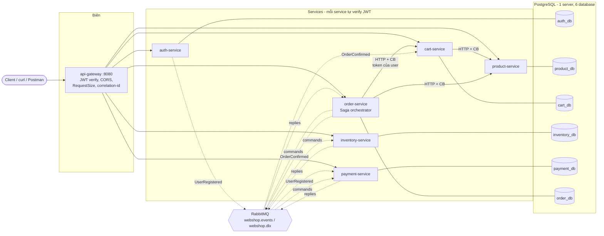
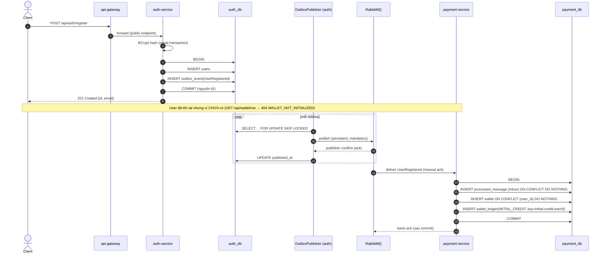
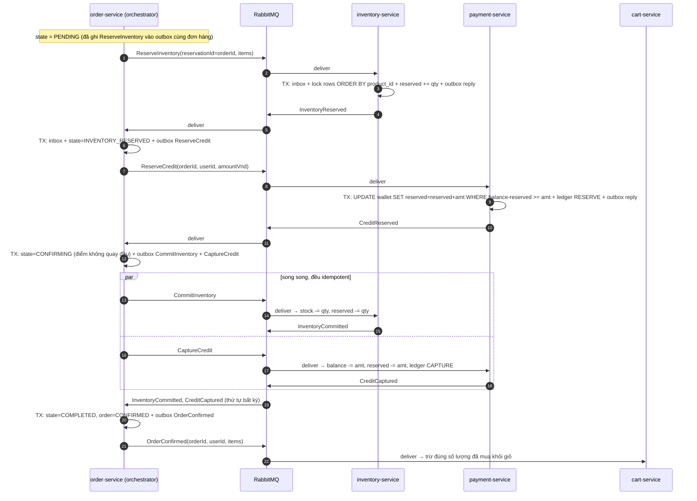
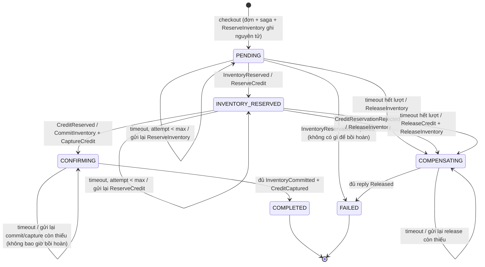
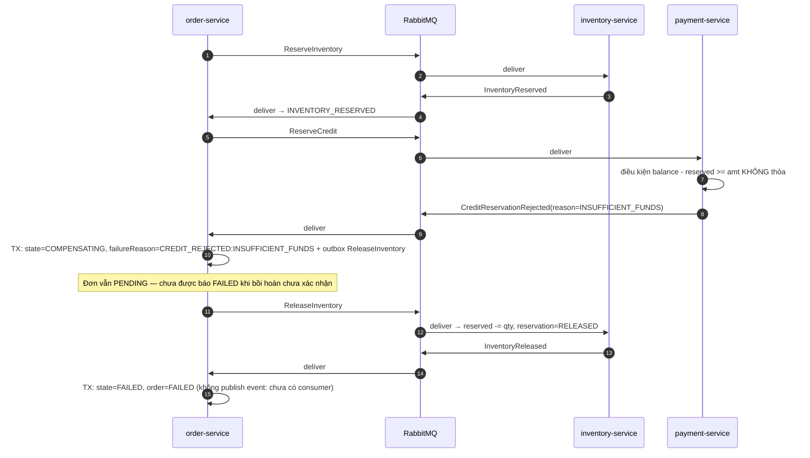
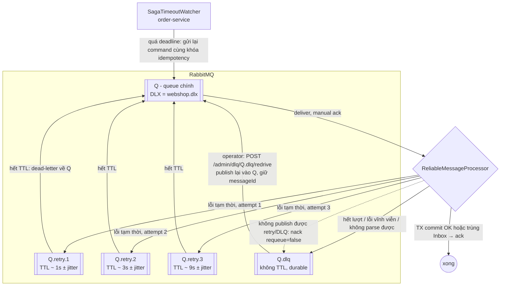

# Kiến trúc hệ thống Webshop Microservices

Tài liệu này mô tả kiến trúc, các luồng chính và lý do tồn tại của từng thành phần. Mã nguồn dùng định danh tiếng Anh;
giải thích bằng tiếng Việt. Các file được nhắc tới có thể mở trực tiếp trong repo.

## 1. Tổng quan thành phần

| Ứng dụng | Port | Database | Vai trò |
|---|---|---|---|
| `api-gateway` | 8080 | — | Điểm vào duy nhất cho client: routing, xác thực JWT ở biên, CORS, giới hạn kích thước request, correlation-id. Không chứa nghiệp vụ. |
| `auth-service` | 8081 | `auth_db` | Đăng ký, đăng nhập, phát hành JWT. Publish `UserRegistered` qua Outbox. |
| `product-service` | 8082 | `product_db` | Danh mục sản phẩm, giá VND (số nguyên), trạng thái active. |
| `cart-service` | 8083 | `cart_db` | Giỏ hàng theo user. Không lưu giá. Gọi Product Service đồng bộ (circuit breaker). Dọn giỏ khi nhận `OrderConfirmed`. |
| `inventory-service` | 8084 | `inventory_db` | `stock_on_hand`, `reserved_quantity`; reserve/commit/release idempotent theo `reservationId`. |
| `payment-service` | 8085 | `payment_db` | Ví credit nội bộ + sổ cái append-only; tạo ví khi nhận `UserRegistered`; reserve/capture/release credit. |
| `order-service` | 8086 | `order_db` | Tạo đơn từ giỏ, snapshot giá, **điều phối Saga checkout** (orchestration). |
| PostgreSQL 16 | 5432 | 6 database | Một server cho tiện local, nhưng mỗi service một database + user riêng, user không có quyền CONNECT chéo. |
| RabbitMQ 4.1 | 5672 / 15672 | — | Topic exchange `webshop.events`, dead-letter exchange `webshop.dlx`, queue durable, retry tiers, DLQ. |

Thư viện dùng chung (không phải service):

- `libs/common-web`: `CorrelationIdFilter`, `GlobalExceptionHandler` (định dạng lỗi thống nhất), `WebshopJwt` (decoder HS256 + mapping role), `ResilientCaller` (Resilience4j circuit breaker + retry cho HTTP), `RestClientFactory` (timeout tường minh).
- `libs/common-messaging`: `EventEnvelope`, `OutboxWriter`/`OutboxPublisher` (Transactional Outbox + polling publisher + publisher confirms), `InboxStore` (dedup), `ReliableMessageProcessor` (ack thủ công, retry tiers, DLQ), `RetryTopology`, `DlqService` (xem/redrive DLQ).



Nét liền: HTTP đồng bộ. Nét đứt: message bất đồng bộ qua RabbitMQ (luôn đi qua Outbox của bên gửi và Inbox của bên nhận).

### Topology RabbitMQ

| Queue (consumer sở hữu) | Binding trên `webshop.events` | Nội dung |
|---|---|---|
| `payment.user-registered.q` | `auth.user.registered` | Event `UserRegistered` |
| `payment.commands.q` | `payment.command.*` | `ReserveCredit`, `CaptureCredit`, `ReleaseCredit` |
| `inventory.commands.q` | `inventory.command.*` | `ReserveInventory`, `CommitInventory`, `ReleaseInventory` |
| `order.saga-replies.q` | `inventory.reply`, `payment.reply` | Mọi reply của participant |
| `cart.order-events.q` | `order.confirmed` | `OrderConfirmed` |

Mỗi queue `Q` có thêm `Q.retry.1..N` (TTL theo từng message, hết hạn thì dead-letter về `Q`) và `Q.dlq` (bind vào `webshop.dlx`).
Topology được khai báo trong code bởi service consume queue đó (`RetryTopology.consumerQueue`), nên service nào sở hữu
queue thì sở hữu luôn cấu hình của nó.

### Envelope message (version 1)

```json
{
  "eventId": "5f0c...",            // khóa dedup ở Inbox, cũng là AMQP message-id
  "eventType": "ReserveCredit",
  "eventVersion": 1,
  "occurredAt": "2026-10-21T14:00:00Z",
  "aggregateType": "Order",
  "aggregateId": "<orderId>",
  "correlationId": "<id của request checkout ban đầu>",
  "causationId": "<eventId của message gây ra message này>",
  "sagaId": "<orderId>",
  "payload": { "reservationId": "<orderId>", "userId": "...", "amountVnd": 3450000 }
}
```

## 2. Đăng ký và cấp credit ban đầu



Ba lớp chống cấp credit hai lần: Inbox (theo `eventId`), `UNIQUE(wallet.user_id)`, `UNIQUE(wallet_ledger.idempotency_key)`.

## 3. Đăng nhập và checkout được bảo vệ

```mermaid
sequenceDiagram
    autonumber
    actor U as Client
    participant GW as api-gateway
    participant A as auth-service
    participant O as order-service
    participant C as cart-service
    participant PR as product-service
    participant ODB as order_db

    U->>GW: POST /api/auth/login
    GW->>A: forward
    A-->>U: 200 {accessToken (HS256: sub, iss, iat, exp, roles)}
    U->>GW: POST /api/orders/checkout + Bearer + Idempotency-Key
    GW->>GW: verify chữ ký, exp, iss (401 nếu sai)
    GW->>O: forward (giữ nguyên Authorization, thêm X-Correlation-Id)
    O->>O: verify JWT LẦN NỮA, userId = claim "sub"
    O->>ODB: đã có đơn với (userId, Idempotency-Key)? → trả lại đơn cũ (200)
    O->>C: GET /api/cart?pricing=false (Bearer token CỦA USER)
    C->>C: verify JWT, đọc giỏ của "sub"
    C-->>O: {userId, revision, items}
    O->>PR: GET /api/products/batch?ids=...
    PR-->>O: giá, tên, active (có thẩm quyền)
    O->>ODB: BEGIN; INSERT orders(PENDING) + order_item snapshot + checkout_saga(PENDING) + outbox(ReserveInventory); COMMIT
    O-->>U: 202 Accepted {orderId, status: PENDING, sagaState: PENDING}
    loop poll
        U->>GW: GET /api/orders/{orderId}
    end
```

## 4. Saga checkout thành công



### Máy trạng thái Saga



Ý nghĩa chính xác từng state nằm trong Javadoc của
[`SagaState`](../order-service/src/main/java/com/webshop/order/saga/SagaState.java); logic chuyển trạng thái ở
[`CheckoutSaga`](../order-service/src/main/java/com/webshop/order/saga/CheckoutSaga.java) (thuần Java, unit test trong
`CheckoutSagaTest`).

## 5. Saga bồi hoàn (compensation)



Khi timeout (không biết participant đã làm hay chưa), Saga gửi release cho **mọi** tài nguyên có thể đang bị giữ theo
thứ tự ngược phụ thuộc (credit trước, hàng sau). Nếu release tới trước reserve (message trễ), participant tạo bản ghi
**tombstone** `RELEASED`, nên reserve tới muộn sẽ bị từ chối thay vì giữ tài nguyên cho đơn đã hủy.

## 6. Transactional Outbox

```mermaid
sequenceDiagram
    autonumber
    participant S as Service (logic nghiệp vụ)
    participant DB as Database của service
    participant PUB as OutboxPublisher (polling)
    participant MQ as RabbitMQ

    S->>DB: BEGIN
    S->>DB: thay đổi nghiệp vụ
    S->>DB: INSERT outbox_event (envelope JSONB, next_attempt_at=now)
    S->>DB: COMMIT
    loop mỗi poll-interval
        PUB->>DB: BEGIN; SELECT ... WHERE published_at IS NULL AND next_attempt_at <= now<br/>ORDER BY created_at LIMIT 50 FOR UPDATE SKIP LOCKED
        PUB->>MQ: basic.publish (persistent, mandatory, message-id = eventId)
        alt confirm ack và không bị return
            MQ-->>PUB: ack
            PUB->>DB: UPDATE published_at = now
        else nack / return / timeout
            PUB->>DB: UPDATE publish_attempts+1, next_attempt_at = now + backoff, last_error
        end
        PUB->>DB: COMMIT
    end
    Note over PUB,MQ: Crash sau khi MQ ack nhưng trước COMMIT → dòng được gửi lại → consumer dedup bằng Inbox
```

## 7. Retry, DLQ và phục hồi



Các tầng retry và chủ sở hữu (tránh nhân retry):

| Tầng | Ai sở hữu | Chính sách |
|---|---|---|
| Client → Gateway | Client | Retry với **cùng** `Idempotency-Key`. Gateway **không** retry. |
| HTTP service → service | `ResilientCaller` ở service gọi | Chỉ GET (idempotent), tối đa 3 lần, backoff mũ + jitter, chỉ lỗi I/O/5xx; circuit breaker riêng từng dependency. |
| Consumer message | `ReliableMessageProcessor` | 4 lần (1 + 3 retry qua retry queue), backoff 1s×3ⁿ ± 20%, trần 30s; rồi DLQ. |
| Outbox publish | `OutboxPublisher` | Vô hạn với backoff mũ có trần 1 phút (broker có thể down lâu); backlog có metric. |
| Bước Saga | `SagaTimeoutWatcher` | Reserve: 3 lần rồi bồi hoàn. Confirm/compensate: vô hạn với backoff có trần, gắn cờ `needs_attention` sau 5 lần. |

Vì sao không bị nhân: gateway không retry; HTTP chỉ retry GET; consumer retry chỉ bao phần xử lý cục bộ (không gọi HTTP
ra ngoài trong handler); Saga retry là tầng nghiệp vụ dài hạn, mỗi lần tạo **một** command mới với cùng khóa nghiệp vụ.

## 8. Bảo mật

- Gateway verify JWT (chữ ký HS256, `exp`, `iss`) và từ chối `/admin/**`. Mỗi service **tự verify lại** và phân quyền
  (`hasRole('USER')`, `hasRole('ADMIN')`), nên gọi thẳng port service vẫn bị kiểm tra.
- `userId` luôn lấy từ claim `sub` của token đã verify. Không endpoint nào nhận userId của chủ sở hữu từ client.
- Order Service đọc giỏ bằng token của chính user (token forwarding) → Cart Service chỉ trả giỏ của `sub` đó.
- Mật khẩu: BCrypt. Event `UserRegistered` không chứa email/mật khẩu. Log không chứa token, mật khẩu, số dư ví.
- Secret chỉ đến từ biến môi trường; `.env` bị `.gitignore`.

## 9. Quan sát (observability)

- Actuator: `/actuator/health`, `/actuator/health/liveness`, `/actuator/health/readiness`, `/actuator/prometheus`.
- Metric tự định nghĩa: `webshop.outbox.backlog`, `webshop.outbox.published`, `webshop.outbox.publish.failures`,
  `webshop.messaging.processed|duplicates|retries|dead-lettered`, `webshop.messaging.dlq.depth{queue}`,
  `webshop.saga.started|completed|failed{reason}|timeouts{state}|needs-attention`, `webshop.saga.in-flight`,
  `webshop.saga.needing-attention`; Resilience4j: `resilience4j.circuitbreaker.state{name}`…; HTTP: `http.server.requests`,
  `http.client.requests`.
- Log JSON (ECS) trong container, có `correlationId` và `sagaId` trong MDC; correlationId đi qua HTTP header
  `X-Correlation-Id` và field `correlationId` của envelope.
- RabbitMQ Management UI: http://localhost:15672.
